  
 
    
 
    

☕ Order up

I'm Nour, a junior .NET backend developer from Egypt. I graduated from Ain Shams University in Statistics and Computer Science (2026), which is why I care as much about the numbers behind a system as the code inside it.

I like the part of the app nobody sees: APIs, data models, auth, and the glue that lets a Flutter app, a .NET API and a Python service agree on what a request means. I take ownership of what I build, and I'd rather understand a design decision than copy one.

🔧 On the bench now: sole backend developer on MediCare, a clinic booking and queue system
🎓 Training: Full Stack .NET track at the Digital Egypt Pioneers Initiative (DEPI)
🏁 Where I'm heading: large backend systems, distributed services and cloud architecture
☕ The menu

Espresso (what I use every day)

Show Image Show Image Show Image Show Image Show Image

Double shot (security and architecture)

Show Image Show Image Show Image Show Image Show Image

On the side (tools and integrations)

Show Image Show Image Show Image Show Image Show Image Show Image

🏁 Featured laps
Project	What it is	My part
InsightHub	Career guidance and job-market platform. Graduation project, 4-member team.	Backend Lead & Integration Architect. Built the career assessment (50 questions, 10 tracks, top-3 paths) and the market-matching algorithm. Connected Flutter, a .NET 10 Web API and a Python FastAPI analytics service. Integrated Adzuna, NewsAPI and QuizAPI.
MediCare	Clinic management and appointment booking system. Team project.	Sole backend developer. Built booking with double-booking protection, a FIFO walk-in queue with grace periods, waiting-time estimates based on queueing theory, role-based account provisioning, and 168 automated tests.
Academic Management System	LMS for students, instructors, courses, exams and grades. ITI final project.	Built it solo in a week: ASP.NET Core MVC, EF Core and Clean Architecture, with Identity roles for Admin, HR, Instructor and Student.
📊 Lap times

   

🔧 Off the clock

When I'm not writing code, I'm usually working on cars. I keep a 1996 Peugeot 405 and a 2011 Kia Carens running myself, and I like knowing how the cooling system or the wiring actually works instead of guessing. I take the same approach with bugs.

 Thanks for stopping by. The coffee's on me next time ☕ 

